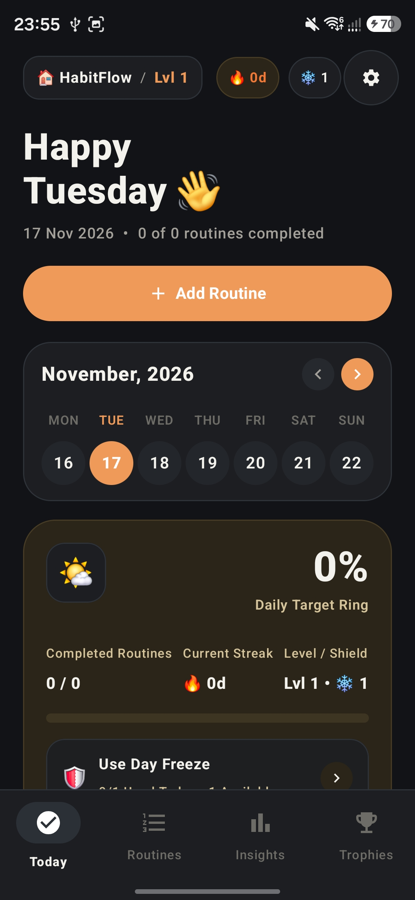
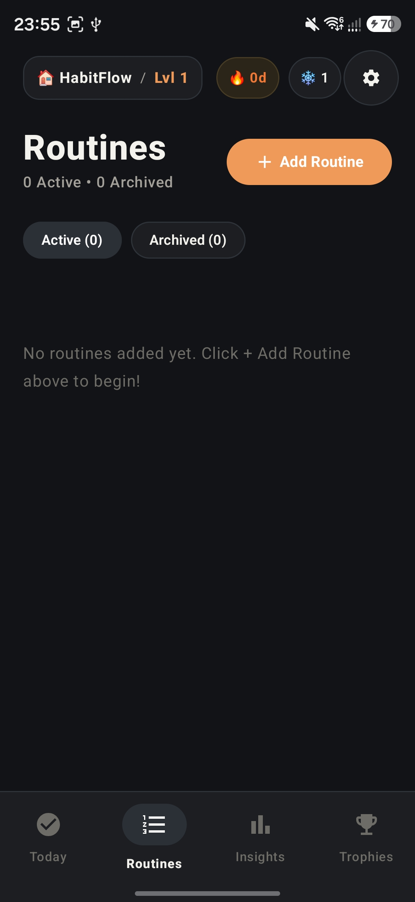
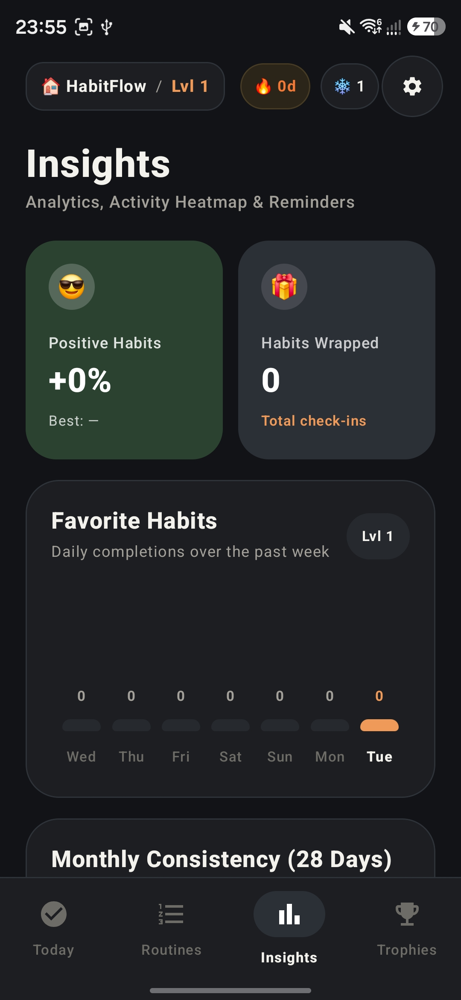
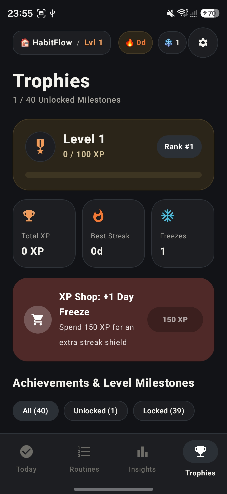

  

<h1 align="center">HabitFlow</h1>

  <b>An offline, gamified Editorial Bento habit tracker for Android.</b> 
  Build daily routines, track measurable goals, earn XP, level up, and protect your streaks — 100% offline.

---

## Screenshots

  
  
  
  

---

## Key Features

### 1. Editorial Bento UI with Adaptive Dark & Light Mode
* Crafted with a warm, tactile **Editorial Bento** aesthetic — warm charcoal & amber cards in **Dark Mode** (enabled by default) and warm cream, butter-yellow, sage-green & terracotta cards in **Light Mode**.
* Instant theme switching inside **Settings (`⚙️`)**.
* Celebratory **Confetti** animations and tactile **Haptic Feedback** when completing daily goals, leveling up, or claiming rewards.

### 2. Today Dashboard & Measurable Habits
* **Date Navigator:** Browse any day of the week with the circular calendar bar (`<` / `>`) or jump straight to Today.
* **Three Habit Types:**
  * **Check (Yes / No):** Single-tap rounded checkbox for classic daily habits.
  * **Counter:** Track numerical goals (e.g., `8 glasses`, `30 pages`) with quick `-` and `+` buttons and a live progress bar.
  * **Timer:** Built-in live countdown timer (`▶` / `⏸`) and quick `+1m` increment button for timed sessions (e.g., `20 min` reading or meditation).
* **Custom Emoji Icons & 6 Categories:** Personalize every habit with an emoji icon (`⚡`, `💧`, `🏃`, `📚`, `🧘`, `💪`, etc.) and category (**General**, **Health**, **Fitness**, **Mind**, **Work**, **Learning**).
* **Smart Filtering:** Filter your daily routines by **Time of Day** (*Morning*, *Afternoon*, *Evening*, *All Day*) and **Category**.

### 3. Day Freezes, Freeze Quests & XP Shop
* **Day Freeze Protection:** Store multiple Day Freezes and activate up to **1 Day Freeze per calendar day** from the Daily Target Ring card to protect your streak when life gets busy.
* **Freeze Quests:** Complete milestone quests to earn bonus Day Freezes and XP rewards.
* **XP Shop:** Exchange **150 XP** directly for an extra **+1 Day Freeze** in the Trophies tab.

### 4. Routines Management (Reordering & Archiving)
* **Custom Ordering:** Reorder your active routines anytime using the `↑` and `↓` arrows.
* **Archive & Restore:** Archive seasonal or paused routines without losing your historical completion stats, and restore them with one tap.

### 5. Insights, Analytics & Smart Reminders
* **Bento Summary Cards:** Track your weekly **Positive Habits** completion rate, best day of the week, and **Habits Wrapped** total check-ins.
* **7-Day Completion Bar Chart:** Visualize your daily completions over the past week.
* **28-Day Monthly Consistency Heatmap:** Circular calendar bubble heatmap highlighting active and 100% completed days.
* **Reminders & Evening Streak Saver:**
  * Set individual daily notification times for any routine.
  * Enable the **Evening Streak Saver** alert to get notified before midnight if you still have unfinished habits for the day.

### 6. Trophies & 40 RPG Milestones
* **RPG Leveling System:** Earn XP from every completed habit and level up from **Level 1** to **Level 100+**.
* **40 Unlockable Achievements:** Unlock badges across Streaks (up to 365 days), Check-In Volume (up to 500 check-ins), Routine Building, Categories, Quests, and XP milestones — complete with **All / Unlocked / Locked** filters and live progress bars.

### 7. 100% Offline & Multi-Language
* **9 Supported Languages:** English, Slovak, Czech, German, Spanish, French, Polish, Ukrainian, and Italian.
* **Local Room Database & JSON Backup:** All data stays 100% private on your device. Export and import full `.json` backups anytime from Settings or Insights.
